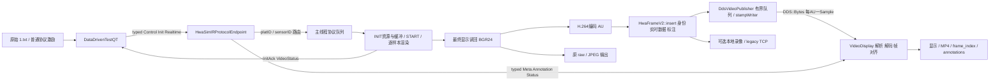

# HwaSimIR DDS 端到端说明（P18）

以当前源码及板端日志为准。历史文档中“原 H.264 只有纯视频”的说法不适用于当前 HwaFrameV2 实现。P18 保留原协议和原链路，另在私有 SEI 注入前分出客户纯视频。

## 原生产链

## P18 完整链

```mermaid
flowchart TD
  S[一个原始激励调度器] -->|RESET平台1001| C[coarse 1001/1]
  S -->|RESET平台1001| P[precise 1001/2]
  S -->|独立INIT 320 raw / 800 H264| C
  S -->|独立INIT| P
  C -->|ACK 1001/1| S
  P -->|ACK 1001/2| S
  S -->|两ACK后START / Realtime sensor255 每行一次| C
  S -->|同一广播| P
  C --> B[每实例原生渲染和BGR读回]
  P --> B
  B --> CE[既有彩色编码 clean AU]
  CE --> COPY[独立复制 clean AU RGB24]
  CE --> SEI[原HwaFrameV2 insert / 原writer stamp]
  SEI --> OLD[原DDS::Bytes + Meta/Annotation/Status]
  OLD --> VD[VideoDisplay / 原录像]
  B --> CQ[客户独立有界完整帧队列]
  COPY --> CQ
  CQ --> RAW[Gray8 / RGB24 tight top-down raw]
  CQ --> GE[需要灰度时中性RGB编码 / 独立gray AU]
  CQ --> RGB[共享彩色clean AU]
  GE --> FRAG[worker串行按最多1400字节切片]
  RGB --> FRAG
  FRAG --> HT[typed TX/HD264 或 TX/LD264]
  RAW --> RT[typed TX/HDecode 或 TX/LDecode 每帧一个Sample]
  HT --> DEMO[独立客户Demo 仅四客户类型]
  RT --> DEMO
  DEMO --> SAVE[增量解析 解码 显示 原始流 MP4]
```

图中两个实例各自有读回、编码和队列，不能解释成两进程共享内存/运行时。进程内部协议、原视频与客户 Writer 共用一个 DdsRuntimeManager；跨进程各自 initCount=1。

## Topic、类型、生产者与消费者

旧 typed 类型完整注册名称为 `HwaSimIRDds::<类型>`，原 IDL 布局不变。下表身份模式为当前生产配置；旧 role 模式仍由现有配置选择。

| Topic | Type / Sample语义 | 方向与作用 | 本阶段状态 |
|---|---|---|---|
| HwaSimIR.Control | ControlCommandV1 | 激励→renderer；RESET=1 START=2 STOP=3；platID级 | 启用 |
| HwaSimIR.Init | InitCommandV1 | 激励→renderer；身份、环境、传感器、尺寸/编码 | 启用 |
| HwaSimIR.InitAck | InitAckV1 | renderer→激励；真实本地身份与trackingReady | 启用 |
| HwaSimIR.Realtime | RealtimeDataV1 | 激励→renderer；源时间、平台、目标、ViewValid/engineState | 启用 |
| HwaSimIR.VideoStatus | VideoStatusV1 | renderer→激励/VideoDisplay；running、round、尺寸、codec和实际videoTopic | 原DDS视频启用时使用 |
| HwaSimIR.Video.1001.1.RawGray8 | DDS::Bytes，整帧 | coarse→旧接收端；原Gray8输出 | 双路主验收启用 |
| HwaSimIR.Video.1001.2.H264 | DDS::Bytes，整AU | precise→VideoDisplay；含HwaFrameV2私有SEI | 双路主验收启用，允许无Reader |
| HwaSimIR.Video.{platID}.{sensorID}.{codec} | DDS::Bytes | codec可H264/RawGray8/RawBGR24；identity解析器 | 其它合法组合保留 |
| HwaSimIR.VideoMeta.{platID}.{sensorID} | VideoFrameMetaV1 | renderer→旧接收端；round/frameSeq/PTS/keyframe/尺寸 | 保留 |
| HwaSimIR.Annotation.{platID}.{sensorID} | AnnotationFrameV1 | renderer→旧接收端；同身份/帧号的JSON | 保留 |
| HwaSimIR.DecodedVideoStatus | HwaSimIRDds::VideoStatusV1 | 可选 decoded gateway→其接收端；通告解码后尺寸和Topic | P18未启动；NOT_VERIFIED |
| HwaSimIR.Decoded.{platID}.{sensorID}.RawGray8 | DDS::Bytes，整Gray8帧 | 可选 decoded gateway→旧raw接收端；默认输出名，可CLI覆盖 | P18未启动；NOT_VERIFIED |
| TX/HD264 | HD264Stream，1..1400有效字节 | precise客户纯H264→客户Demo | 新增，实际收发 |
| TX/LD264 | LD264Stream，1..1400有效字节 | coarse客户纯H264→客户Demo | 新增，实际收发 |
| TX/HDecode | HDDecoder，整raw帧 | precise客户raw→客户Demo | 新增，实际收发 |
| TX/LDecode | LDDecoder，整raw帧 | coarse客户raw→客户Demo | 新增，实际收发 |

原 protocol endpoint 保留状态与辅助 Topic；客户分支不发布客户 Status/Meta/EOS。旧 VideoDisplay 还观察 Control/Init/Realtime，并通过状态的实际 Topic 选择/切换流。可选 decoded gateway 是单独部署的旧 H.264 解码转发工具，使用其既有 decoded Topic/Status，与四个 TX typed 类型不是同一协议。本阶段主验收未启动 gateway；详见仓库既有 gateway 工程/配置，不能把它当作客户接收依赖。

legacy UDP 是显式控制兼容入口，legacy TCP 是原有 init/control、video/realtime/annotation payload 通道（Packet v3/HwaFrameV2 等各自原格式），都不等于 typed TX 接口。正常 P18 控制选择 DDS；客户独开测试同时关闭旧 DDS 视频、本地录像及四类 TCP payload。保留 legacy 代码，不用重复 UDP+DDS 激励冒充一份输入。

## 身份与配置优先级

renderer `main.cpp` 选择启动配置的顺序为：显式 `--network-config`（配套 `--channel`，未给时 precise）→显式 `--channel`→`HWASIMIR_NETWORK_CONFIG`（配套 HWASIMIR_CHANNEL）→HWASIMIR_CHANNEL→原默认。随后 `LoadNetworkConfig` 读取该 INI 的 Identity.channel/platID/sensorID；实际日志 `RuntimeInstance` 才是运行身份。它不是根据 INIT 中目标平台 ID 动态改名。

| 字段 | 含义 |
|---|---|
| 本地 Identity.platID | 本 renderer 所在/被控制的平台；正式两路1001 |
| 本地 Identity.sensorID | 本 renderer 的传感器；coarse=1、precise=2 |
| 顶层 INIT/Realtime platID+sensorID | 接收路由身份；255仅为允许的sensor广播 |
| platParamInit.id | 初始化平台对象/模型状态中的平台标识，不替代传感器路由 |
| targetPlatID、targetID | 被观测目标的完整身份组成部分；连同targetType解析目标 |
| channel | coarse/precise实例角色；P19与合法sensorID（1..254）解耦，原始身份Topic仍使用platID/sensorID |

Control 无 sensorID，同平台两个实例都处理 RESET/START/STOP；现协议不能单独 STOP 1001 的某 sensor。Init/Realtime 先验 platID，再接受精确 sensor 或启用的255广播；本地状态和 ACK 始终报1/2，不能报255。目标查找继续使用完整 targetType+targetPlatID+targetID；数字标注与稳定编号(x,y)不改。

`HWASIMIR_RUNTIME_CONFIG` 为 P18 新增的单文件 runtime 路径覆盖；给定后不能读到文件即启动失败。未给定仍按原候选路径查找。各 runtime 配置的环境变量 > INI > 默认。Identity 来自 network INI，不从本地目标身份回推。

有效 INIT 的 trackerSensorWidth/Height/h264En 优先决定本回合缓冲和请求编码；HeadlessWidth/Height 是启动/回退尺寸。P18 日志验证 coarse rawScene/final=320；底层512的POT纹理存储不代表800渲染后缩小。像元角单位µrad，总FOV约为尺寸×像元角；25µrad下320约0.458°、800约1.146°。同激励保持相同业务状态，不保证同总视场或相同像素。

INIT 非法（包括客户raw容量）不发成功ACK。INIT有效后两份真实ACK才START；随后等待两路原VideoStatus.running，再逐行播放。客户独开时旧VideoStatus不提供客户ready语义，测试采用控制DDS ACK+明确2000ms settle，不声称这是客户应用层ready ACK，最终由板端accepted/output/drain和接收实数验证。

## 帧身份、排空与录像

源行→接受sourceSeq→执行→本回合logicalFrameSeq→读回/编码。相同像素不表示重复帧，完整4318产品按逻辑身份和日志核验。原首659行隐藏语义保留。HwaFrameV2 SEI 保存原业务实时状态、身份、标注和阶段时间；原 writer 在独立原分支上 stampWriter；原接收对齐并保存 frame_index.jsonl、annotations、producer/target annotations与MP4。旁路Meta不能代替SEI自包含产品的实际解析检查。

客户压缩分片没有帧身份，不能直接以Sample数作帧数；通过发送本地审计AU长度/SHA、重建流SHA、解析解码帧数和ffprobe保存数证明。客户raw frameId对齐logicalFrameSeq，每回合重置1。客户协议无回合字段，接收端需要外部配置管理回合边界；客户Demo不依赖旧Status来猜测。

STOP先完成已接受输入与读回/输出，再分别排空旧DDS及客户队列。原 DDS 保持原有队列/QoS，客户新增完整帧队列默认32，typed write每次上限100ms，排空默认5000ms。客户失败标记并中止该回合；异步worker不在渲染线程逐分片阻塞。客户重开不隐含补齐离线内容。输出目录/配置/licence副本按实例或测试隔离，不改系统永久配置。

## 源码函数索引

| 文件 | 关键函数/职责 |
|---|---|
| HwaSim_IR/HwaSim_IR/main.cpp | main / ReadOptionValue：CLI和环境实例选择 |
| HwaSim_IR/HwaSim_IR/HwaSimIR.cpp | BuildRuntimeConfigCandidatePaths、LoadNetworkConfig、LoadD2VideoOutputConfig、INIT处理、capture_task：配置/本地身份/容量拒绝/读回 |
| DDS/Runtime/DdsRuntimeManager.cpp | start、participantForDomain、shutdown：一次Init/Finalize，按域缓存CreateDP |
| DDS/Protocol/ProtocolRoute.h | EvaluateProtocolRoute：平台/传感器过滤 |
| DDS/Protocol/HwaSimIRProtocolEndpoint.cpp | start及发布函数：typed旧协议endpoint |
| DDS/Protocol/CommonDataDdsAdapter.cpp | ToDds/FromDds：旧布局转换 |
| DDS/Protocol/VideoTopicResolver.h | ResolveVideoTopic / ResolveIdentityTopicPattern |
| DataDrivenTestQT/mainwindow.cpp | enableDualCustomerChannels、sendInitCommand、sendControlCommand、sendRealTimeData、prepareNextAutoRound：两INIT/ACK/广播/回合 |
| DDS/Protocol/DdsStimClient.cpp | sendControl/Init/Realtime、waitForRunningStatus/StopStatus：双身份状态屏障与本地输入审计 |
| HwaSim_IR/HwaSim_IR/TcpCommThread.cpp、TcpCommThread_Linux.cpp | startOutputRound、stopOutputRound、sendFrameThreadFunc、sendFramePacket：独立输出门控、编码前分流、旧SEI保留 |
| HwaSim_IR/HwaSim_IR/Video/CustomerDdsVideoPublisher.cpp | validate/start/beginRound/submit/Impl::run/endRound：通用客户队列、转换、编码、记账 |
| DDS/CustomerTX/CustomerVideoContract.h | imageBytes/convertBgr/fragments/validLength/topic/type：唯一跨平台契约 |
| DDS/CustomerTX/CustomerTxWriter.h | open/send/drain：typed SDK writer、实际QoS验证 |
| HwaSim_IR/HwaSim_IR/Video/DdsVideoPublisher.cpp | configureTopic/enqueue/worker/endRound：旧Bytes队列和stamp |
| DDS/Protocol/FrameProductV2.h | insert/extract/stampWriter：原私有SEI |
| HwaSim_IR_VideoDisplay/HwaSim_IR_VideoDisplay/DdsVideoReceiverWorker.cpp | start / 状态切换与视频接收：原解码/对齐入口 |
| DDS/HwaSimIRCustomerTxVideoReceiverDemo/main.cpp | Listener::copy、Receiver::push/run/packet/flush/saveMedia：纯客户接收 |
| DDS/HwaSimIRCustomerTxVideoReceiverDemo/CustomerAvSha256.h | update/finishHex：已有FFmpeg SHA256，完整审计摘要保持不变 |
| HwaSim_IR/Bin/Config/GameVFX/sprite.vert、sprite.frag | 连续体积包络与积分：仅P18尾焰外形调整 |
| HwaSim_IR/HwaSim_IR/IR/P5GraphicsTest.inl | bindOpaqueFixtureDepth：生成的诊断喷口/遮挡板使用现有P17对数深度；生产模型与天气不变 |

具体可复制命令、实例配置和依赖见 [双路操作手册](HwaSimIR_P18_DualChannel_Runbook.md)；接口约定见 [客户ICD](HwaSimIR_Customer_TX_DDS_ICD.md)。实际计数、失败记录和性能结论见 [P18结项记录](HwaSimIR_P18_Closeout.md)。

## P19 更新

客户raw故障仅停止客户本回合，STOP/RESET/独立INIT/ACK/START可在同PID恢复；进程级DDS运行时不重复初始化。客户H264正常STOP追加标准结束NAL并优先排空；旧分支SEI/实时数据/标注保留，健康Writer不再执行固定5秒STOP等待。Domain1现场与Domain150实验配置分开导出。当前启动、测试与限制以[P19结项](HwaSimIR_P19_Closeout.md)和[源码索引](HwaSimIR_P19_Source_Index.md)为准。

## P19 恢复测试后的独立域支持

控制、原VideoDisplay视频、客户TX视频现在分别由 DdsProtocol / DdsVideo / CustomerDdsVideo 的 DomainId 控制。同域复用Participant，异域在同一个Factory下创建Participant；完整默认值、环境覆盖、状态镜像及实测见 [DDS域配置](HwaSimIR_P19_DDS_Domains.md)。
